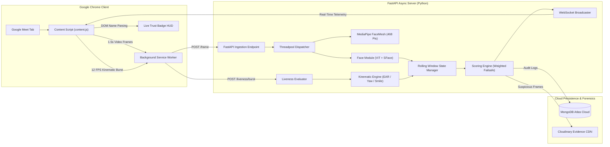

<div align="center">

# 🛡️ HumanTrust AI

### Multi-Modal Human Authenticity & Kinematic Liveness Verification Engine

[](https://www.python.org/)
[](https://fastapi.tiangolo.com/)
[](https://developer.chrome.com/docs/extensions/)
[](https://pytorch.org/)
[](https://developers.google.com/mediapipe)
[](https://www.mongodb.com/atlas)
[](https://cloudinary.com/)
[](LICENSE)

*An in-call, real-time trust verification system operating alongside video conferencing platforms (Google Meet) to detect generative AI deepfakes, mid-call identity swaps, and virtual camera injection through continuous multi-modal scoring and interactive kinematic liveness challenges.*

</div>

---

## 📌 Table of Contents
- [Overview](#-overview)
- [Key Features](#-key-features)
- [System Architecture](#-system-architecture)
- [AI & Machine Learning Engine](#-ai--machine-learning-engine)
- [Directory Structure](#-directory-structure)
- [Getting Started](#-getting-started)
  - [Prerequisites](#prerequisites)
  - [Backend Setup](#1-backend-setup)
  - [Chrome Extension Setup](#2-chrome-extension-setup)
- [How to Use in Google Meet](#-how-to-use-in-google-meet)
- [SDG Alignment & Green Computing](#-sdg-alignment--green-computing)
- [Author & Acknowledgments](#-author--acknowledgments)

---

## 📖 Overview

The rapid proliferation of consumer Generative AI tools has made real-time face-swapping, deepfake video streams, and synthetic audio cloning readily accessible. Mainstream video conferencing platforms like Google Meet, Zoom, and Microsoft Teams provide zero native defenses against synthetic video injection, creating severe vulnerabilities in remote job interviews, banking KYC onboarding, and proctored examinations.

Conventional academic deepfake detectors operate offline on pre-recorded MP4 files with high computational latency. **HumanTrust AI** bridges this gap by introducing an **in-call, non-intrusive trust framework** that calculates a continuous **Human Authenticity Score** in real time. It operates directly in the browser via a lightweight Chrome Extension and verifies that a real, living, and authorized human participant is actively present.

---

## ✨ Key Features

- **In-Meeting Live HUD Trust Badge:** Injects a dynamic, floating status badge directly into Google Meet (`🟢 Verified ≥80`, `🟡 Moderate 60–79`, `🔴 Suspicious <60`).
- **Google Meet Display Name Auto-Detection:** Automatically discovers joined participant display names using multi-stage DOM parsing while filtering out UI control noise (*"Reframe"*, *"Mute"*, *"Pin"*, *"Effects"*), with a 1-click manual rename override (`✎`).
- **Smart Screen Share Filter:** Automatically distinguishes between human webcam streams and active screen shares / presentations, preventing false *"No face detected"* alerts on shared slides.
- **Dual-Signal Face Verification:**
  - **Authenticity (Deepfake Detection):** Vision Transformer (ViT) classifier trained to detect diffusion and GAN generative artifacts, calibrated against lossy webcam compression noise.
  - **Identity Consistency:** SFace ONNX deep neural network generating 128-dimensional unit embeddings with an Exponential Moving Average (EMA) adaptation algorithm to handle natural head tilt, lighting shifts, and camera angle adjustments.
- **Interactive Kinematic Liveness Challenges:**
  - Issues dynamic single-use prompts (*"Turn head left"*, *"Turn head right"*, *"Blink twice"*, *"Smile"*).
  - Records a high-speed **12 FPS burst stream** for 6 seconds.
  - Evaluates Eye Aspect Ratio (EAR), 3D head yaw/pitch, and lip corner kinematics, scoring the response in under 1 second.
  - Features a **3-minute TTL expiry** to prevent stale liveness credentials.
- **Forensic Cloud Evidence & Notifications:**
  - Automated Cloudinary visual snapshot upload for frames flagged as suspicious.
  - Persistent, tamper-evident audit logging in MongoDB Atlas.
  - Real-time Chrome OS desktop push notifications with explicit diagnostic root-cause notes.
- **Green AI Architecture:** Runs on consumer CPU hardware consuming $<15\text{W}$, eliminating the carbon footprint and costs of high-wattage GPU server farms.

---

## 🏗️ System Architecture



---

## 🧠 AI & Machine Learning Engine

| Component | Model / Algorithm | Purpose | Specifications |
|---|---|---|---|
| **Facial Authenticity** | **Vision Transformer (ViT)** | Detects synthetic / GAN / Diffusion artifacts | `prithivMLmods/Deep-Fake-Detector-v2-Model` (~340 MB), PyTorch CPU runtime, compression floor `0.65` |
| **Identity Consistency** | **SFace CNN** | Prevents mid-call person swaps & impostors | 128D unit embeddings, Cosine Distance metric, EMA reference tracking: $\vec{u}_{\text{ref}} = 0.95 \cdot \vec{u}_{\text{ref}} + 0.05 \cdot \vec{u}_{\text{new}}$ |
| **Facial Landmarks** | **MediaPipe FaceMesh** | 3D geometric landmark tracking | 468 3D landmarks, thread-local instance pooling on CPU |
| **Blink Kinematics** | **Eye Aspect Ratio (EAR)** | Liveness blink validation | $\text{EAR} = \frac{\|p_2 - p_6\| + \|p_3 - p_5\|}{2 \|p_1 - p_4\|}$ |
| **Head Rotation** | **3D Pose Projection** | Directional head turn detection | Nose tip vector relative to zygomatic cheek boundaries (Yaw / Pitch) |
| **Smile Kinematics** | **Lip Corner Expansion** | Facial kinematic expression validation | Inter-pupillary normalized mouth corner distance expansion |

---

## 📂 Directory Structure

```
human-trust-ai/
├── .vscode/
│   ├── launch.json              # 1-Click F5 debug & run configuration for FastAPI
│   └── settings.json            # Automatic virtualenv interpreter binding
├── backend/
│   ├── modules/
│   │   ├── face.py              # Dual-signal ViT authenticity + SFace identity engine
│   │   ├── landmarks.py         # Thread-safe MediaPipe 468 FaceMesh extractor
│   │   └── liveness.py          # Kinematic analyzers (EAR, Yaw/Pitch, Smile expansion)
│   ├── received/                # Temporary local media storage (git-ignored)
│   ├── .env.example             # Template for MongoDB Atlas & Cloudinary credentials
│   ├── config.py                # System weights, model thresholds & timing parameters
│   ├── db.py                    # Motor asynchronous MongoDB connection
│   ├── evidence.py              # Cloudinary REST integration for forensic uploads
│   ├── main.py                  # FastAPI application & REST/WebSocket endpoints
│   ├── pipeline.py              # Verification checking, alert dispatch & evidence triggers
│   ├── requirements.txt         # Pinned Python package dependencies
│   ├── scoring.py               # Dynamic weighted trust score calculation engine
│   ├── state.py                 # Multi-participant rolling window state tracker
│   └── ws_manager.py            # Real-time WebSocket connection manager
├── dashboard/                   # Web monitoring dashboard
├── extension/
│   ├── icons/                   # High-res extension icons (128x128 RGBA)
│   ├── background.js            # MV3 service worker, WebSocket client & notification manager
│   ├── content.js               # Meet DOM crawler, video frame capture, HUD overlay & challenge banner
│   ├── manifest.json            # Chrome Extensions Manifest V3 configuration
│   ├── offscreen.html           # Offscreen DOM for tab audio capture
│   ├── offscreen.js             # MediaStreamRecorder audio chunking logic
│   ├── popup.html               # Session launcher popup interface
│   └── popup.js                 # Session control script
├── .gitignore                   # Multi-tier exclusion for secrets, venvs & media
└── README.md                    # Project documentation
```

---

## 🚀 Getting Started

### Prerequisites
- **Python:** Version 3.10 or 3.11 recommended
- **Browser:** Google Chrome (v116+ for Manifest V3 Offscreen API)
- **Cloud Accounts:**
  - [MongoDB Atlas](https://www.mongodb.com/atlas) (Free M0 Cluster)
  - [Cloudinary](https://cloudinary.com/) (Free tier account for forensic image hosting)

---

### 1. Backend Setup

1. **Clone the repository:**
   ```bash
   git clone https://github.com/pushkarrastogi-2005/HumanTrustAi.git
   cd HumanTrustAi/backend
   ```

2. **Create and activate a virtual environment:**
   ```bash
   # Windows (PowerShell)
   python -m venv venv
   .\venv\Scripts\Activate.ps1

   # Linux / macOS
   python3 -m venv venv
   source venv/bin/activate
   ```

3. **Install dependencies:**
   ```bash
   pip install --upgrade pip
   pip install -r requirements.txt
   ```

4. **Configure environment variables:**
   Copy `.env.example` to `.env`:
   ```bash
   cp .env.example .env
   ```
   Edit `.env` with your credentials:
   ```env
   MONGODB_URI=mongodb+srv://<username>:<password>@cluster.mongodb.net/?retryWrites=true&w=majority
   DB_NAME=humantrust
   CHECK_INTERVAL_S=3
   SAVE_MEDIA=1
   EVIDENCE_ENABLED=1
   EVIDENCE_COOLDOWN_S=30
   CLOUDINARY_URL=cloudinary://<api_key>:<api_secret>@<cloud_name>
   ```

5. **Start the FastAPI server:**
   ```bash
   # Run directly with uvicorn:
   python -m uvicorn main:app --reload --reload-dir . --port 8000
   ```
   *(Or press **`F5`** in VS Code to launch using the preconfigured `.vscode/launch.json`)*

   Verify that the server is online at [http://localhost:8000/docs](http://localhost:8000/docs).

---

### 2. Chrome Extension Setup

1. Open Google Chrome and navigate to `chrome://extensions`.
2. Enable **Developer mode** (toggle in the top-right corner).
3. Click **Load unpacked** in the top-left corner.
4. Select the `extension/` folder inside the cloned repository:
   ```
   HumanTrustAi/extension
   ```
5. The **HumanTrust AI** extension icon will now appear in your browser toolbar.

---

## 💻 How to Use in Google Meet

1. Join or start any video call on [Google Meet](https://meet.google.com).
2. Click the **HumanTrust AI** extension icon in your browser toolbar and click **Start verification**.
3. **Live Trust Badge:** A floating badge will appear in the top-right corner displaying each participant's name and trust score (e.g. `Pushkar: 98 | Verified`).
4. **Trigger an Interactive Challenge:**
   - Click the **Challenge** button next to any participant's name.
   - An on-screen prompt will instruct the verifier (e.g., *"Ask Pushkar: Turn head left"*).
   - The participant performs the action; the extension captures a 12 FPS burst and displays the result within 1 second.
5. **Screen Share Demonstration:**
   - When any participant shares their screen, HumanTrust AI automatically filters out the presentation feed—evaluating only genuine camera video feeds.
6. **Audit Logs & Alerts:**
   - Open MongoDB Atlas to view structured logs in the `scores` and `alerts` collections.
   - Suspicious events automatically generate and link visual evidence snapshots on Cloudinary.

---

## 🌍 SDG Alignment & Green Computing

| Sustainable Development Goal | Contribution |
|---|---|
| **SDG 9: Industry, Innovation & Infrastructure** | **Green AI Architecture:** Eliminates high-power GPU server consumption by optimizing computer vision models (SFace ONNX, MediaPipe) to run on commodity CPUs at $<15\text{W}$, reducing the carbon footprint of AI verification. |
| **SDG 16: Peace, Justice & Strong Institutions** | **Anti-Fraud & Institutional Integrity:** Directly mitigates synthetic identity theft, deepfake extortion, and impersonation fraud across online exams, legal depositions, and banking KYC. |
| **SDG 8: Decent Work & Economic Growth** | **Secure Remote Work:** Fosters trusted, fraud-free remote hiring and distributed employment opportunities globally without geographical barriers. |

---

## 👤 Author & Acknowledgments

- **Developer:** [Pushkar Rastogi](https://github.com/pushkarrastogi-2005)
- **Institution:** Department of Computer Science, CHRIST (Deemed to be University), Bangalore
- **Project:** BCA (Honours) Major Project — *SDG Green Tech*

---

<div align="center">
  <sub>Built with ❤️ for a safer, more authentic digital future.</sub>
</div>
